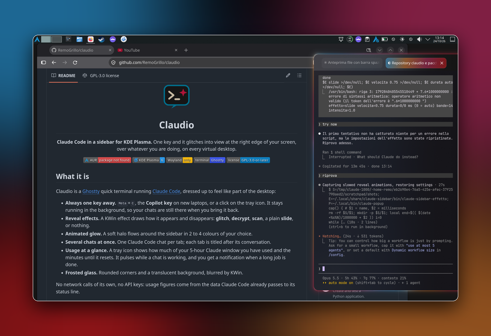
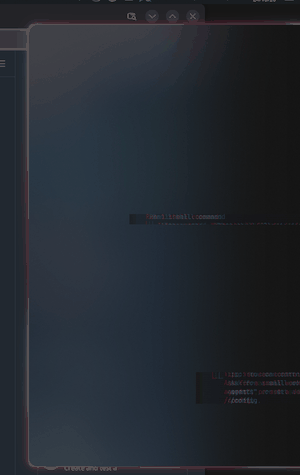
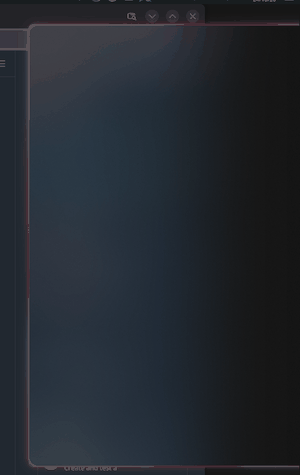
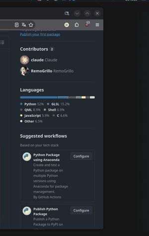
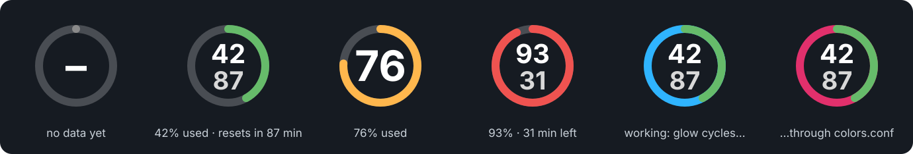
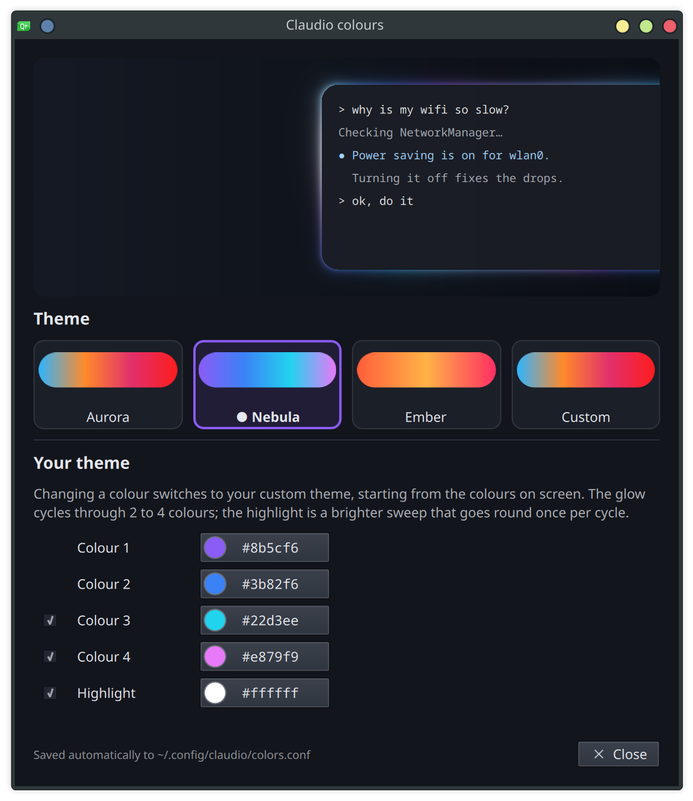

<div align="center">


# Claudio

**Claude Code, woven into your Linux desktop.**<br>
One key and it's ready for action: Claude glitches into view at the edge of your screen,
over whatever you're doing, on every virtual desktop. Press it again and it's gone.

[](https://aur.archlinux.org/packages/claudio)




</div>

## What it is

Claudio is an instant interface to [Claude Code](https://code.claude.com/docs) that turns it into **your personal Linux
assistant**, built right into KDE Plasma instead of living in a terminal you have to go and find.

No terminal to open, no `cd`, no `claude` to type, no window to arrange. Press <kbd>Meta</kbd>+<kbd>C</kbd> (or the Copilot
key) and Claude is already there, floating over your work, ready to fix a config file, find out why a service won't start,
explain a log, write a script or tidy up your Downloads folder. Press the key again and it steps aside, still running,
with every conversation exactly where you left it.

Juggling several things at once? Open a **tab per task**: each one is its own Claude Code session, named after its
conversation, so one can refactor a project while another sorts out your printer. The tray icon tells you which ones are still
working and pings you when a long job is done.

- **Always one key away.** <kbd>Meta</kbd>+<kbd>C</kbd>, the **Copilot key** on new laptops, or a click on the tray icon.
  It lives in the background, on every virtual desktop, above every window.
- **Many chats, one place.** <kbd>Ctrl</kbd>+<kbd>Shift</kbd>+<kbd>T</kbd> for a new chat, <kbd>Alt</kbd>+<kbd>1</kbd>…<kbd>9</kbd>
  to jump between them; tabs are titled automatically by Claude Code.
- **Feels native.** Frosted glass, rounded corners and an animated glow in your own colours, so it looks like part of Plasma,
  not a terminal that wandered in.
- **Reveal effects.** A KWin effect draws how it appears and disappears: **glitch**, **decrypt**, **scan**, a plain **slide**, or nothing.
- **Usage at a glance.** A tray icon shows how much of your 5-hour Claude window you've used and the minutes until it resets,
  and pulses while Claude is working.

Under the hood it's a [Ghostty](https://ghostty.org) quick terminal running Claude Code, with a KWin effect, a KWin script and a
small tray app around it. Made on Arch Linux, for any distro with Plasma 6 on Wayland.

No network calls of its own, no API keys: usage figures come from the data Claude Code already passes to its status line.

## Reveal effects

<table>
  <tr>
    <td align="center" width="33%"><br><b>glitch</b><br><sub>bands jerk into place with RGB split, flicker and scanlines</sub></td>
    <td align="center" width="33%"><br><b>decrypt</b><br><sub>green glyphs churn, then resolve into the terminal top to bottom</sub></td>
    <td align="center" width="33%"><br><b>scan</b><br><sub>a cyan line sweeps across a blurred hologram</sub></td>
  </tr>
</table>

Nothing is there before the effect starts: the frosted blur behind Claudio fades in with the content, and the glow
traces itself along the edge, from the top right corner round to the bottom, in step with the reveal.

<sub>Recorded slowed down so you can see what happens; the real thing takes 0.3 to 0.65 seconds
(adjustable). There are also <b>slide</b>, a clean slide in from the edge, and <b>none</b>.</sub>

Pick one from the tray menu, with `claudio-effect glitch|decrypt|scan|slide|none`,
or in *System Settings → Window Management → Desktop Effects → Claudio reveal*.
Speed, intensity and the number of glitch bands are adjustable too.

## Tray icon

<div align="center"></div>

<!-- screenshot to add: docs/screenshots/tray-menu.png (right-click menu) -->

| Action | What happens |
|---|---|
| Left click | show/hide Claudio |
| Middle click | notification with session and weekly usage, and which chats are working |
| Right click | menu: show/hide, usage details, **Reveal animation** (effect, speed, intensity, glitch bands) and **Glow** (on/off, theme, colour editor) |
| Hover | the same details as a tooltip |

The ring is green, then amber from 70% and red from 90%; the small number below is the minutes until the 5-hour window resets.

## Colours and themes

<div align="center"></div>

The glow, the pulsing tray icon and the active tab share one palette. Pick a built-in theme, **Aurora**, **Nebula** or
**Ember**, straight from the tray menu (*Glow → …*), or open the colour editor (*Glow → Customise colours…* or
`claudio-colors`) to make your own: 2 to 4 colours plus an optional highlight that sweeps round the glow. The preview at the
top is drawn by the same shader as the real glow, and every change is applied live.

## Requirements

- **KDE Plasma 6 on Wayland** (KWin effects and scripts, global shortcuts through the desktop portal)
- **Ghostty** 1.3 or newer
- **Claude Code** — from the [native installer](https://code.claude.com/docs/en/setup) or the `claude-code` AUR package
- Python 3 with PyGObject, `qdbus6`, `kioclient`, `kwriteconfig6` (all part of a normal Plasma install)
- Optional: [Better Blur DX](https://github.com/xarblu/kwin-effects-better-blur-dx) for a stronger frosted-glass look

The tray icon on its own also works in other StatusNotifierItem trays (it just cannot open the sidebar there).

## Install

### Arch Linux (AUR)

```bash
yay -S claudio          # or paru, or: git clone https://aur.archlinux.org/claudio.git && cd claudio && makepkg -si
claudio-setup           # once, as your own user
```

### From source

```bash
git clone https://github.com/RemoGrillo/claudio.git
cd claudio
make                            # builds noslide.so and the shaders (needs qt6-shadertools and wayland headers)
sudo make install PREFIX=/usr   # or skip this and run everything straight from the checkout
claudio-setup                   # or ./bin/claudio-setup from the checkout
```

`claudio-setup` is per user and safe to run again. It:

1. copies the default colours to `~/.config/claudio/colors.conf`;
2. enables the KWin effect `claudio_reveal` and the KWin script `claudio-glow`;
3. adds autostart entries for Claudio, the tray icon and (if your user can read the keyboards) the Copilot key;
4. adds Claudio's hooks and status line to `~/.claude/settings.json` (a backup is saved next to it).
   If you already have a status line it is left alone: `claudio-setup --statusline` replaces it.

Then press <kbd>Meta</kbd>+<kbd>C</kbd> (or run `claudio-toggle`). The first time, KDE asks you to allow Claudio's global shortcut.

## Usage

| Keys | |
|---|---|
| <kbd>Meta</kbd>+<kbd>C</kbd> / Copilot key | show/hide Claudio |
| <kbd>Ctrl</kbd>+<kbd>Shift</kbd>+<kbd>T</kbd> | new chat in a new tab |
| <kbd>Ctrl</kbd>+<kbd>Shift</kbd>+<kbd>W</kbd> | close the tab |
| <kbd>Ctrl</kbd>+<kbd>Tab</kbd>, <kbd>Alt</kbd>+<kbd>1</kbd>…<kbd>9</kbd> | switch chat |

Change the global shortcut in *System Settings → Keyboard → Shortcuts → Claudio*.

**Copilot key.** It sends <kbd>Meta</kbd>+<kbd>Shift</kbd>+<kbd>F23</kbd>, which KDE's shortcut system cannot bind.
`claudio-copilot-key` reads the keyboards directly to catch it, so your user needs to be in the `input` group
(`sudo usermod -aG input $USER`, then log in again and rerun `claudio-setup`). It only listens for that one key.
Keep in mind that membership of `input` lets any program you run read keyboard input.

## Configuration

| File | What |
|---|---|
| `~/.config/claudio/colors.conf` | glow, tray and active-tab colours: the theme in use and your custom one (easier with `claudio-colors`); picked up live |
| `~/.config/claudio/ghostty.conf` | your Ghostty overrides for Claudio only: size, opacity, font… |
| `kwinrc` → `[Effect-claudio_reveal]` | reveal effect settings (use `claudio-effect` or the tray menu) |

For example, a wider and more opaque sidebar:

```ini
# ~/.config/claudio/ghostty.conf
quick-terminal-size = 40%,90%
background-opacity = 0.85
```

`claudio-effect` without arguments prints the current reveal settings:

```text
$ claudio-effect
effect=glitch speed=1.0 duration=0/0 ms (0 = auto) bands=14 intensity=1.0
$ claudio-effect decrypt && claudio-effect speed 1.5
```

## How it works

| Piece | Role |
|---|---|
| `claudio` | starts a dedicated Ghostty instance (`io.github.remogrillo.claudio`) as a quick terminal docked to the right |
| `noslide.so` | `LD_PRELOAD`ed into that Ghostty only: hides KWin's slide protocol so the reveal effect can draw instead |
| `claudio_reveal` | KWin effect (JavaScript + GLSL) animating the sidebar in and out |
| `claudio-glow` | KWin script (QML + a Qt shader) drawing the halo around the sidebar, with a hole for KRunner |
| `claudio-tab` | runs `claude` in each tab |
| `claudio-statusline` | Claude Code status line; saves the usage limits to `~/.cache/claudio/usage.json` |
| `claudio-hook` | Claude Code hook; tracks which Claudio chats are working, notifies when long jobs finish |
| `claudio-tray` | StatusNotifierItem tray icon with a dbusmenu settings menu |
| `claudio-colors` | colour editor (QML), with a live preview of the glow |
| `claudio-toggle` | shows/hides Claudio through KDE's global shortcut, starting it if needed |
| `claudio-copilot-key` | turns Copilot key presses into `claudio-toggle` |

## Uninstall

```bash
claudio-setup --remove   # as each user; keeps ~/.config/claudio
sudo pacman -R claudio   # or: sudo make uninstall PREFIX=/usr
```

## Troubleshooting

- **Nothing happens on <kbd>Meta</kbd>+<kbd>C</kbd>:** check that Claudio is running (`pgrep -f claudio.conf`) and that the
  shortcut is listed under *Shortcuts → Claudio*. Running `claudio-toggle` from a terminal starts it if needed.
- **No animation, or KWin's own slide:** `qdbus6 org.kde.KWin /Effects org.kde.kwin.Effects.isEffectLoaded claudio_reveal`
  should print `true`; `journalctl --user -b | grep claudio_reveal` shows shader errors.
- **The tray icon shows "–":** Claude Code has not sent usage data yet (send a message), or another status line is configured
  (`claudio-setup --statusline`).
- **No glow:** the glow script needs `glow.frag.qsb`, built by `make`; after a big Qt update rebuild it.

## Credits

Made by [Remo Grillo](https://github.com/RemoGrillo). Claudio is an unofficial project, not affiliated with or endorsed by
Anthropic; Claude and Claude Code are trademarks of Anthropic.

Licensed under the [GNU GPL v3 or later](LICENSE).
